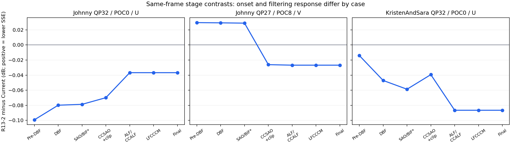

# R13-2：Johnny / KristenAndSara 异常点诊断

日期：2026-10-24。正式参考始终为 Current；R13-1 是空间权重的机制对照。
本轮允许本地编码，采用服务器完整日志核验＋短前缀闭环＋只读观察，不重新跑完整 CTC。
起始源码：`bd0f36c6cb822fd7016d603aed87c7d6afa95a13`，分支 `experiment/ts-predictor-study`。

## 1. 问题与比较口径

逐 QP 列仅将对应 QP 的完整实验 RD 元组替换进 Current 四点曲线，其余三点仍取 Current。
分别计算 Y/U/V BD-rate 后按 `(6Y+U+V)/8` 加权；单位为 %，负数表示改善。
下表来自已登记的正式 300 帧实验，不使用短测估计 BD-rate。

| 点 | R13-1：Y / U / V | R13-1：6:1:1 | R13-2：Y / U / V | R13-2：6:1:1 |
| --- | --- | ---: | --- | ---: |
| Johnny QP27 | +0.077822 / −0.689584 / +0.330094 | +0.013430 | −0.064489 / +0.163450 / +1.411016 | **+0.148442** |
| Johnny QP32 | −0.025676 / −0.000307 / +0.336913 | +0.022819 | −0.020721 / +1.110085 / +0.855742 | **+0.230187** |
| Johnny QP37 | +0.039771 / −0.051436 / +0.081236 | +0.033554 | +0.039303 / +0.170586 / +0.191000 | **+0.074675** |
| KristenAndSara QP32 | −0.199309 / +1.330500 / −1.365002 | −0.153794 | +0.201160 / +1.217772 / −0.677239 | **+0.218436** |

不能用一个“色度 predictor 失效”的解释覆盖四点：

- Johnny QP27/32 的 Y 仍改善，色度损失反转总结果。
- Johnny QP37 三分量均损失；独立读取工作簿复算一致。端点会影响 PCHIP 端点及邻接斜率，也可能改变公共积分区间，其影响不应预设为零。
- KristenAndSara QP32 对 R13-1 的加权结果差为 +0.372231 个百分点，其中 Y +0.300351、U **−0.014091**、V +0.085970。主要是 Y 从收益变损失及 V 收益减少，U 并没有进一步恶化。这是同参考结果差，不冒充两方法直接积分的 BD-rate。
- 同为 E 类的 FourPeople QP32，R13-2 的 U/V 均改善，6:1:1 为 −0.068622%；不能据异常点推导统一色度或高 QP 禁用规则。

## 2. 服务器日志核验

只读核验 `experiments/ts_predictor_r13/` 下三对日志：`Johnny_27_*`、`Johnny_32_*`、`KristenAndSara_32_*`。
每份日志含 300 条编码帧记录和 10 遍完整解码，即 3000 条解码帧记录。解析器只将含 bits/PSNR 的记录算作编码帧，避免重复计算。

- 六份合计 1800 编码帧、18000 解码帧，解码 MD5 均与编码端一致并报告 OK。
- 配对工具配置、逐帧 POC / slice type / temporal ID / 实际 QP 一致；均 1 I＋299 B、TId=0。
- R13-2 身份为 `R13-KH-168-v1`、mode 2、22111，旧 stats/trace 关闭。
- 六份最终码率和 Y/U/V PSNR 与正式台账一致。原服务器源码、程序和输入文件 hash 未提供，不能据此认证全部运行环境。
- 本地 Johnny QP32 的 Current / R13-2 前 5 帧、Johnny QP27 的两者前 17 帧、
  KristenAndSara QP32 的两者首帧及 R13-2 前 17 帧，与对应服务器前缀的 bits、hex double 精度 PSNR、重建 MD5 全部一致，提供了实际复现证据。

| 300 帧：R13-2 − Current | 码率变化 | ΔY dB | ΔU dB | ΔV dB |
| --- | ---: | ---: | ---: | ---: |
| Johnny QP27 | +0.373074% | +0.009741 | −0.001664 | −0.058883 |
| Johnny QP32 | +0.310258% | +0.010258 | −0.057479 | −0.046209 |
| KristenAndSara QP32 | +0.592419% | +0.003485 | −0.061335 | +0.062047 |

Johnny QP32 的 U 损失在 POC0 已出现；KristenAndSara QP32 的 POC0 也已有 U 损失。
Johnny QP27 的 V 从 POC8/9 开始转差，前 17 帧平均仍接近零、前 33 帧才明显为负，因此不能只用第 1 帧判定其长期原因。
Johnny QP37 没有服务器逐帧日志，正式数据审计不能恢复其时间轨迹。

## 3. 源码机制与本轮诊断设计

R13 使用因果邻域 `H=(L,U,D,LL,UU)` 的非零幅值；`n` 是非零槽位数，不是独立幅值数。
`n<3` 回 Current；否则候选为 Current、恒等映射及历史非零幅值，重复幅值合并成本但保留支持数。
R13-1 权重 11111，R13-2 权重 22111。严格更小才替换，平局保持既有优先次序。

对于真实幅值 `a` 和候选 `p`，remapping 为：

```text
a=0                       -> 0
p<=1                      -> a
a=p, p>1                  -> 1
0<a<p                     -> a+1
a>p                       -> a
```

KeepHit 的 ±1 奖励以历史幅值为代理，假设下一位置有相应量化调整机会；它不是当前未量化残差的真实 RD 最优值。
RDOQ 中 predictor 同时改变 mapped-level rate，以及额外向上候选是否进入搜索（只有该候选映射为 1 时加入）。
随后 CG 可能整组清零、TU 可能输给其它模式，最终重建又会参与空间预测、跨分量工具和后续参考帧。
因此必须分别观察固定 q 码率、同入口局部量化和整个编码轨迹，不能用其中一种替代另一种。

本轮增加三层纯观察，默认关闭：

1. **最终 Writer**：在真实 CG 入口复制 CABAC context 和 regular-bin budget，对相同最终 q 分别模拟 Current / uniform / spatial 完整 CG；每分支独立更新且不写回。下一 CG 重新从真实入口开始，因此是逐 CG 条件反事实，不是全 TU 替代码流。
2. **RDOQ search trial**：保持真实历史、残差、lambda、context、budget，分别固定原 level 候选及重新建立 predictor 相关候选，记录 p/q/search 改变、ΔD/λ、ΔR、ΔJ/λ。所有 trial 都纳入，含最终未获选 TU；按实际 CG 是否全零分开。统计绝不写回真实 q、context 或搜索计数。
3. **整帧各滤波阶段**：逆 LMCS 后、DBF、SAO/BIF、CCSAO clip、ALF/CCALF、LFCCCM、final clip，记录各分量原始 SSE、hash 及 64×64 分量坐标网格。覆盖 coded buffer；当前 720p 无 padding。不是 WPSNR，也不是每阶段独立重新优化的滤波消融。

另增加 **实际编码消融** `TS_R13_DIAG_SCOPE=luma|chroma`：仅指定分量使用原 R13，其余使用 Current。
它改变码流，启动日志单独标注；编解码必须使用同一 scope，无额外信令。`all` 默认保留原算法。
其作用是识别直接分量路径和间接传播，不能称为新正式 R13 版本或混入正式 BD-rate 台账。

RDOQ 的 `m_dLambda` 乘的是 fractional bins，诊断按 `lambdaPerBit=m_dLambda*32768` 换算。
记录的 D 是内部 RDOQ 缩放域，不是像素 SSE；逐位置归一后累加，不能用总 D 除以平均 lambda。

## 4. 本地运行与结果

使用 LBeu 配置、原始 1280×720 8bit 4:2:0 60fps，内部 10bit。
“LB 半帧”是源 600 帧取前 300 帧，**不设置隔帧采样**；短测取同一前缀。
不保存重建视频；生成临时码流并解码检查 MD5。观察开启运行时间不作为算法复杂度数据。

最初 Johnny QP32 前 5 帧的 R13-1 / R13-2 完整码流相同，SHA256 为
`737b1dd62ccbc7822c54f03c69386eef8c27ca3d01e2f75889efb8a394cf48b9`。
二者最终 TS 均为 9 TU、100 CG、1600 位置、39 非零，**全部属于 Y**；Current 为 8 TU、92 CG、46 非零，也全部属于 Y。
这说明早期 U 损失不能直接归为最终色度 TS 的错误 remapping，也不是该前缀 22111 相对 11111 的独有效应。
但它没有排除未获选色度 TS trial 对搜索的影响，故需要上述分量消融继续判断。

### 4.1 Johnny QP32 首帧：已完成的因果分量消融

四组均成功编码、解码 hash 通过。完整码流而不只是四位小数 PSNR 满足：

```text
R13-2(all) == R13-2(luma only)
Current   == R13-2(chroma only)
```

各阶段整帧及全部 tile 的重建 hash / SSE 也分别一致。即使 U/V 保留 Current predictor，
仅在 Y 启用 R13-2 也足以重现首帧色度损失；只改变色度 predictor 没有改变该帧输出。
这是本帧的编码干预证据，而不是由“最终色度 TS 数为零”单独推断的结论。

| 首帧阶段：all − Current | ΔY dB | ΔU dB | ΔV dB |
| --- | ---: | ---: | ---: |
| before DBF | +0.006118 | **−0.099201** | −0.044575 |
| after DBF | +0.006468 | −0.079854 | −0.065470 |
| after SAO/BIF（待clip） | +0.000116 | −0.078707 | −0.052709 |
| after CCSAO＋clip | +0.003439 | −0.069889 | −0.067636 |
| after ALF/CCALF | +0.006436 | −0.036776 | −0.003073 |
| final clip | +0.006364 | **−0.036776** | −0.003073 |

这里 ΔdB 由同阶段相同原图的 SSE 比值计算。U 的 SSE 先增加 **2.31048%**，
最终增幅降至 **0.85039%**；环路滤波总体缓解了已存在的损失，并非首次制造该损失。
第 0 帧是 I 帧，没有参考帧传播，也不进入本工程 LFCCCM 的非 I 帧 RDO。

源码确认了滤波前真实存在的 Y→UV 通道：LMCS 根据已重建 Y 邻域决定色度残差 scale，
并相应调整 UV 量化 lambda；CCLM/CCCM 直接使用重建 Y；其它搜索、划分和 context 变化也可能传播。
当前观察尚未把这几条通道逐一隔离，因此结论是 **Y 编码决策变化→滤波前色度重建变化**，
不是“已确定 CCCM 有 bug”或“已确定由某一个 LMCS scale 引起”。
实际开关、行号及后处理判读见 [源码传播路径核验](results/r13_diagnosis_20261024/source_paths.md)。

同首帧固定 q 的最终 TSRC 估计：Current 轨迹用 C/U/S 分别为
237.5134 / 241.1182 / 241.1182 bit；R13-2 轨迹为 203.9574 / 205.0322 / 205.0322 bit。
这两行 q 和获选块不同，不能跨行相减充当节省。每行内部的 R13 代价都略高于 Current，
但仅 +3.6048 / +1.0748 bit，无法单独解释整个色度 RD 变化。

R13-2 首帧 Y 的 11,701,504 个 RDOQ 搜索位置中，同入口 Current probe 改变 p 80,678 次、
改变 q 3,660 次；固定候选与重新建立候选的 q 有 584 次不同。
U probe（等权）相对实际空间加权改变 p 47,311 次、q 2,812 次，native/fixed q 差 138 次。
即使最终选中块的 U/S 映射一致，**搜索过程也并不相同**。
这些数目包括多次访问同一位置的被淘汰 trial，不能当成图像独立系数样本或实际写入次数。

纯观察验证：新诊断开启后 Johnny QP32 完整 5 帧码流与修改前冻结程序 byte-exact；
逐帧 hex PSNR、MD5、bits 也一致。局部 native fixture 中 Current/U/S 新旧及观察开/关完整 payload 一致；
U/S 的 all/luma/chroma Writer/Reader 系数、context、budget 一致，BDPCM 跨模式/scope 一致。
每组覆盖 180 个语法 TU / 1718 CG，加 240 个 RDOQ TU（32 个发生 CG 清零）。

### 4.2 KristenAndSara QP32 首帧：不是相同的局部评分问题

Current / R13-1 / R13-2 首帧分别为 116576 / 116384 / 116544 bit。
R13-2 对 R13-1 多 160 bit，但 Y/U 分别改善约 +0.0052 / +0.0245 dB，V 约 −0.0012 dB。
这和完整 300 帧 Y 退化的方向不相同，故增加 17 帧同前缀对照观察传播，不能直接外推首帧。

R13-2 对 Current 的 U SSE 增量：滤波前 +27,536 → CCSAO＋clip 后 +69,628 → ALF/CCALF 后 +132,365。
最终 U 为 −0.086538 dB。与 Johnny QP32 相比，这里的合并 ALF 阶段放大已有损失；
仍然不是损失首次出现的位置。I 帧未进入 LFCCCM，不能把此变化归到 LFCCCM。

三种轨迹均没有 U 最终 TS；V 各仅 1 TU、5 个非零，C/U/S 固定 q 代价完全相同（23.6328 bit）。
Y 中空间与等权只在 **1 个系数 / 1 个 CG** 上产生不同的实际 remapping，空间加权反而省 **1.507416 bit**。
这不支持将 160 bit 直接归因于所选 TS 的局部 U/S remapping 码长差。
逐 CG 重置真实入口的模拟没有跟踪替代方案向后续 CG/其它语法传播的 CABAC context，
也没有固定跨轨迹最终 q 与分块，因而不是全码流差额的精确分解。

在各自固定真实历史上，R13-2 相对 R13-1 的 Y 分量局部 RDOQ ΔJ/λ：
Current 轨迹 −15542.987、等权轨迹 −17216.526、空间轨迹 −16739.434，均在这三组局部试验中支持空间加权。
每个值只在本轨迹内部配对，不跨轨迹相加；重复搜索 trial 也不提供独立统计显著性。
与 Johnny 首帧局部等权更好的情形相反，**本点首帧没有证据把代价增加归为统一的错误局部 rate 排序**。
局部评分、TU/模式决策及最终 YUV 闭环目标之间仍有差距。

### 4.3 Johnny QP37 首帧：没有复现完整段的负向质量变化

Current / R13-2 为 53792 / 53840 bit，后者多 48 bit；Y/U/V 反而分别改善
+0.002770 / +0.027276 / +0.007072 dB。两组最终 TS 均只有 Y，U/V 的全部局部 RDOQ probe 连 p 都未改变。
R13-2 轨迹的固定 q 代价 S−Current 为 +0.79352 bit，S−U 为 0。

首帧没有重现正式 300 帧的 U/V 损失；不能把 QP32 的初始 U 负偏移解释直接移到 QP37。
QP37 的完整点已通过独立数值复算确认，但后期首次转折没有被本轮 1 帧观察定位。
源码还有名义 QP≥37 且 slice QP≤名义 QP＋1 时的 CCALF 限制，
说明两个 QP 不能默认共享全部滤波路径；本轮不据此断言该门控造成损失。

### 4.4 Johnny QP27：17 帧捕获滤波阶段的转折与无 TS 帧的代价变化

三个方法均完成 POC0–16。R13-2 相对等权累计多 **1288 个编码帧 bit（+0.498159%）**，
平均 ΔY/ΔU/ΔV 为 **−0.003226 / +0.000580 / +0.011097 dB**。
对 Current，平均 V 仍为 +0.002296 dB，不能称这段已经重现完整 300 帧的 −0.058883 dB。
上传完整日志的 POC17–32 已平均下降 −0.051839 dB，本轮短测主要定位早期转折。

POC8 的 V 变化提供直接阶段证据：

| 阶段：R13-2 − Current | ΔV dB |
| --- | ---: |
| before DBF | +0.029529 |
| after DBF | +0.029223 |
| after SAO/BIF | +0.028818 |
| after CCSAO＋联合clip | **−0.026147** |
| after ALF/CCALF、最终 | **−0.026836** |

CCSAO＋clip 阶段的 V SSE：Current 3,671,075→3,563,881，等权 3,650,689→3,528,240，
空间 3,646,796→3,585,402。三者都改善；空间版少获得了一部分改善，导致原有优势转成劣势。
这是相同原图下各自闭环滤波响应的差异，不能写成“空间版 CCSAO 增大自身误差”，
也不能把含联合裁剪的阶段观察当作单独关闭 CCSAO 的因果实验。

同段 **POC16 三种轨迹都没有最终 TS，空间版却比等权多 2072 bit**；
它超过整个 17 帧净增加量，意味着其它帧存在抵消。
非 TS 当帧仍可能受到此前参考帧和当帧被淘汰的 TS 搜索影响；不能把全帧差额归给最终 TS 语法。

等权和空间在 POC0 的 bits、YUV MD5 及各自最终 q 上的 U/S 反事实 remapping 已分叉。
POC1–16 各轨迹最终获选 TS 上的 U/S remapping 差为零，但搜索内部仍不同：
Y 的同历史 S−U 局部 ΔJ/λ 在 C/U/S 三个入口轨迹分别为 +2975.737 / +2042.069 / +6262.448，
固定候选时分别 +2966.878 / +2168.196 / +6236.018。
同一候选列表下已经存在大部分局部 RD 差异，不能主要归因于新增 up 候选；
这些仍是被反复访问的搜索 trial，不能当最终码流损失相加。

### 4.5 KristenAndSara QP32：17 帧显示首帧优势不能代表后续帧

R13-1 / R13-2 前 17 帧分别为 171520 / 173304 个编码帧 bit；空间版多 **1784 bit（+1.040112%）**。
平均 ΔY/ΔU/ΔV（空间−等权）为 **−0.003283 / −0.005986 / +0.021209 dB**。
首帧 Y/U 优势已转为短段平均损失，但 V 仍改善，不应写成完整 300 帧三个分量变化都已重现。

POC8 多 856 bit，POC16 多 520 bit，合计 1376 bit；两个位置虽有最终 Y TS，
各自固定 q 上的 U/S remapping 和码率估计均相同。
全部 17 帧的局部 U/S remapping 差仍只有 POC0 的 1 个系数，累计反事实节省 1.507416 bit。
U 始终没有最终 TS，V 仅 POC0 的同一个小 TU。
因此需要观察搜索与整个编码轨迹，而不能只根据最后写入的 TS 系数解释 1784 bit。

局部 RDOQ 也有时间分化：POC0 的同历史评分支持空间加权，但 POC1–16 的
S−U ΔJ/λ 在等权/空间入口轨迹分别为 **+1431.253 / +1394.572**，
固定候选时 **+1466.912 / +1393.357**，方向转为等权较低。
如果把样本极多的首帧与后续帧直接总计，首帧会掩盖这段差异。
这些结果提示评分校准需区分帧阶段和搜索人口，但还不是一个经泛化验证的 I/B 门控规则。



图中每列都是同一帧、同阶段相对 Current 的 SSE 比值换算，正值表示误差更低；
SAO/BIF 为待联合裁剪 buffer。它展示差异首次出现/反转的位置，不是独立关闭滤波器的实验。

### 4.6 Johnny QP32：第一次权重分叉发生在一个没有最终 TS 的帧

等权与空间版 POC0–15 的 bits、精确 YUV PSNR、重建 MD5 都相同。
进一步按本工程 NAL header 核验，两份码流前 16 个完整图像及其 suffix SEI **逐字节相同**；
第一处不同字节位于偏移 15943，属于 POC16 VCL 前的 prefix APS，前 15937 字节完整 NAL 前缀相同。
这不是“APS 是根因”的判断：该帧在 `before_dbf` 已有重建差异，APS 参数是编码决策的后续结果。

POC16 首次出现分叉：空间比等权少 168 bit，ΔY/U/V 为
**−0.004989 / −0.014515 / +0.002227 dB**。两条轨迹该帧 **都没有最终 TS residual**；
17 帧的最终 TS 仅在 POC0、8 出现 Y，UV 从未出现。
整个 17 帧各自固定最终 q 的 U/S remapping、CG 估计 rate 都相同。
该帧 U/V 的局部 RDOQ probe 也没有 p/q 变化，而 U 在滤波前已增加 14734 SSE，ALF 后增至 20172。

因此，第一次权重分叉不能由“之前已解码参考图像不同”或“该帧最后写入 TS 的 U/S remapping 不同”解释。
结合搜索 trial 的差异，证据指向 **编码器内部候选评估和搜索决策反馈**。
具体哪个候选、剪枝或缓存动作首先改变尚未追到，不把它直接写成 RDOQ 候选扩展错误、缓存 bug 或 CABAC 状态泄漏。

源码确实存在以下通道，而且相关快算法在本次配置开启：

| 已确认的源码通道 | 位置 | 与本次推断的边界 |
| --- | --- | --- |
| TS 在局部暂时成为 bestTU 后，停止后续 transform 组 | `InterSearch.cpp:7611`、`:7837`；`IntraSearch.cpp:4090`、`:4167` | 即使整个 CU 最终落选，它的候选列表/成本已改变；本次 TransformSkipFast=1，但尚未记录具体触发位置 |
| BT/TT 候选在判断是否全局获胜前先保存成本，并用于后续 TT 剪枝 | `EncModeCtrl.cpp:1969`、`:2079`、`:1914` | 本次 TTFastSkip=31；未获选方案也可影响后续搜索 |
| 局部 SBT/transform 历史保存不要求 bestChanged | `EncCu.cpp:4286`、`:4094` | 缓存在根 CU/CTU 搜索入口 `:558` 清零，不能据此声称跨帧缓存是根因 |

表中均为 `source/Lib/EncoderLib/` 下文件。
`EncCu.cpp:453` 明确恢复 CU 入口 CABAC context；目前没有状态泄漏证据。
值得优先追踪的是 POC16 的首个搜索分支，而不是继续统计同一批最终 TS 的命中率。

17 帧空间−等权平均 ΔY/U/V 为 −0.000293 / −0.000854 / +0.000131 dB，帧 bits 为 −0.12645%。
这不是完整 300 帧那种明显净损失，也没有解释全部 +0.230187% 的逐 QP BD-rate。
已定位首帧相对 Current 的色度损失路径，以及权重版本首次分叉的发生层级，尚未分解全段每一份损失。

### 4.7 可以下结论的范围

三处主要点有不同机制，不能统一归为粗 `syntaxCost`、色度 predictor 或某一种滤波器出错。

- **运行/数据问题**：六份服务器日志的编码数据、重复解码 hash 和本地对应前缀均核验通过；没有发现配置错配或解码失配，但服务器程序源码 hash 仍未知。
- **评分与搜索目标不一致**：同历史局部 RDOQ 的 U/S 优势随内容和帧阶段改变；固定候选列表下仍有大部分差异。它是校准线索，不是当前系数 oracle 可以直接进 decoder 的依据。
- **最终系数统计不充分**：没有最终 TS、或最终 q 的 U/S remapping 完全相同的帧仍可出现真实差额。本轮的搜索人口和分量消融弥补了只观察最终 TS 的局限。
- **跨分量与后处理反馈**：Johnny32 起始损失由 Y 路径传到滤波前 UV；Johnny27 POC8 在 CCSAO＋clip 阶段反转；K&S32 首帧在 ALF/CCALF 阶段放大 U 损失。不能从阶段差异推导关闭该工具一定改进整体 RD。
- **未解决**：Johnny37 的后期转折、Johnny32 POC16 的首个实际搜索分支，以及 300 帧总体损失的各路径占比。首帧/17帧结论不能冒充全段因果分解。

本轮完成 17 组诊断共 133 编码帧，另有修改前冻结程序 3 组共 15 帧；所有帧完成解码 MD5 核验，未保存重建视频。
运行是重复前缀及多个干预轨迹，148 是工作量，不是 148 个独立统计样本。最长单组 17 帧，没有完整 300 帧本地重跑。
并发起初 3，确认 12 逻辑 CPU、23 GiB 内存资源后上限改为 6，空位随时补位；不以这些时间比较算法复杂度。

原始本地日志在 `runs/r13_diagnosis_20261024/`，可提交的派生表和验证记录在
[独立诊断数据目录](results/r13_diagnosis_20261024/README.md)。正式整体与逐 QP BD-rate 均未替换或补点。

## 5. 工具及复现入口

- `scripts/ts_r13_log_diagnosis.py`：服务器日志身份、编码帧、重复解码 hash、时窗及误差审计。
- `scripts/ts_r13_diagnostic.py`：最终 Writer 与 RDOQ trial 解析、分母和 RD 恒等式校验。
- `scripts/ts_r13_frame_diagnosis.py`：配对阶段 SSE、原图 hash、tile/frame 守恒及局部误差变化。
- `TS_R13_DIAG=1` 启用纯观察；`TS_R13_DIAG_MAX_POC` 默认 31；`TS_R13_DIAG_COMPONENT=0/1/2` 可限分量；`TS_R13_POC` 可限单帧；`TS_R13_DETAIL_LIMIT` 限 CG 示例数。
- `TS_R13_DIAG_SCOPE=all|luma|chroma` 是编码干预，与观察开关独立。非 all 只允许用于 R13，并纳入 batch 指纹，禁止误复用已有正式模式 done 标记。

所有新开关默认关闭或 all。没有新增 predictor、经验阈值或正式实验编号。

以下为复现入口示例，不会覆盖本次冻结运行目录；输入路径按所在服务器调整。
短测可以沿用已编译程序，正式实验仍按原 TypeDef 宏选择。本轮诊断用运行参数显式锁定身份。

```bash
cmake --build build/ts-r14 --target EncoderApp DecoderApp TsR13NativeTest -j6

TS_R13_DIAG=1 TS_R13_DIAG_MAX_POC=4 TS_R13_DETAIL_LIMIT=12 \
TS_R13_STATS=0 TS_R13_TRACE=0 TS_R13_DIAG_SCOPE=all \
python3 scripts/batch_test.py --preset LBeu --class E --sequences Johnny \
  --qps 32 --frames 5 \
  --fixed-predictors current,r13_keep_hit_uniform,r13_keep_hit_spatial \
  --encoder build/ts-r14/bin/EncoderApp --decoder build/ts-r14/bin/DecoderApp \
  --input-dir /home/zhy/videos --jobs 3 --decode-md5 --no-recon --no-xlsm-report \
  --out-dir runs/r13_diagnosis_manual

# 分量消融时仅运行 R13；此环境设置同样传给 Decoder。
TS_R13_DIAG=1 TS_R13_DIAG_MAX_POC=0 TS_R13_DIAG_SCOPE=luma \
python3 scripts/batch_test.py --preset LBeu --class E --sequences Johnny \
  --qps 32 --frames 1 --fixed-predictors r13_keep_hit_spatial \
  --encoder build/ts-r14/bin/EncoderApp --decoder build/ts-r14/bin/DecoderApp \
  --input-dir /home/zhy/videos --jobs 1 --decode-md5 --no-recon --no-xlsm-report \
  --out-dir runs/r13_diagnosis_manual_luma
```

`scripts/ts_r13_collect_diagnosis.py --case-root <结果任务根目录> --output-dir <派生目录>`
只读取成功 done 标记，重新核对逐帧解码 MD5，输出逐运行、逐帧、stage、最终 Writer 与 RDOQ 搜索表。
诊断运行不可用于编码复杂度对比；不要将这些观察开关带进正式计时。
`batch_test.py` 默认根据成功标记和指纹续跑，无 `--resume` 参数；修改 scope 或观察请求会改变指纹。

## 6. 验证与下一步优化顺序

本轮通过18项Python单元检查、7组native模式/scope校验、20组短帧的逐帧解码MD5。
native还逐CG验证 replay 的fractional bits、context、regular budget与原生CABAC estimator完全一致。
新诊断133帧的tile/frame SSE守恒，final SSE恢复的PSNR与日志hex double最大差小于1e−10 dB。
观察开启/关闭的本地5帧码流bit-exact；本轮没有另做master宏关闭的完整构建，新核心代码受既有master宏保护。
正式算法、默认模式和bitstream syntax未改；只有显式scope消融改变对应分量的算法选择。

下一步建议先做**控制流定位，再优化评分**，不增加一批没有证据的predictor或QP阈值：

1. **最优先：Johnny32 POC16 的首次搜索分叉。** 在同入口比较真实获选/落选CU的成本、TS临时bestTU、transform剪枝与BT/TT/SBT历史写入。
   可先用相同配置对两方法同时关闭TransformSkipFast做短诊断；若差异仍在，再单独检查TT剪枝。
   每次只改变一个搜索因素；这是定位实验，不把换了快算法配置的结果直接与原CTC anchor计算正式BD-rate。
2. **评分优化先分层。** 将同历史的直接命中、KeepHit ±1奖励、固定候选/额外候选、首帧/后续帧分开，
   研究哪些实际切换缺乏稳定局部RD支持。若缩小22111的作用或加入保守fallback，仍必须只用decoder可得历史决定；
   本轮用到原残差、lambda和真实RDOQ代价的探针只能诊断，不能直接成为隐式decoder算法。
3. **保留闭环正反对照。** 后续改法除了这几个异常点，还要覆盖已有正收益FourPeople等内容，
   保留Current为正式anchor、R13-1为权重机制对照。避免通过专门禁用Johnny、高QP或色度得到表面改善。
4. **暂不优先扩大全套rate-estimator或候选搜索。** Johnny32大部分局部U/S差在固定候选列表下已经存在；
   K&S首帧真实局部估计甚至支持空间版，却不能预测后续帧/整体结果。现有证据不支持只换更复杂CABAC评分就一定解决问题。

需要精确量化完整300帧损失时，再延长有明确目标的轨迹；本轮已留下默认关闭、可按POC和分量限流的观察工具。
目前不宣称某个新优化已经产生BD-rate收益，也不因几个异常点否定空间权重在其它内容上的全部价值。
