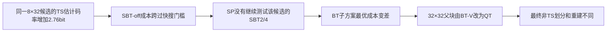

# R13 异常点续查：从码流定位保留结果，再追编码器搜索

日期：2026-10-24。同步基线：`ea09d6a`，参考新增的[后续分析指导](TS_Predictor_R13_Anomaly_Followup_Guide_20261024.md)。
正式 anchor 仍为 Current；下文 C0=Current，EQ=R13-1 等权，SP=R13-2 空间加权，避免用 U 同时指等权方法和色度分量。
本轮修改仅为默认关闭的只读观察接口，没有更改 predictor、搜索规则或码流语法。
没有新增正式 CTC 点，没有用短前缀计算 BD-rate；原正式整体和逐 QP 结果均保留。

## 1. 为什么先解码，以及本轮能够回答什么

本地没有新增服务器300帧 `.bin`。本轮先复用上一轮已核验的本地短前缀码流，
恢复最终 CU/TU、量化系数、运动和跨分量模型、各滤波阶段的重建状态。
这些信息无需重新执行编码搜索。源视频仅用于可选的 SSE 计算，不参与解码或隐式 predictor 推导。

解码器能解释最终获选语法、模型及重建的传播，不能恢复被淘汰的 TS 候选、临时最优、
BT/TT 成本、候选枚举或编码器缓存。因而只有 Johnny32 POC16 的搜索分叉需要重新编码到目标帧，
并把重型搜索日志限制在解码已定位的 CTU36。

本轮数据位于[派生结果目录](results/r13_followup_20261024/README.md)。原始日志、码流和程序留在 `runs/r13_followup_20261024/`，不上传。

## 2. Johnny32 POC16：首个保留分叉已经精确到共同父节点

EQ/SP 的前16个完整图像码流相同；POC16 最终两条轨迹都没有 TS，这一旧证据保持成立。
新增解码观察表明，POC16 前1871条 CU/TU/CTU 语义记录一致（忽略纯日志序号）。
首次最终 CU 与重建分歧位于 CTU36，亮度 CTU 区域 `(768,384,128,128)`。

共同32×32父节点为 `(832,384,32,32)`：

| 项目 | EQ | SP |
|---|---|---|
| 父节点划分 | 垂直二叉分割 | 四叉分割 |
| 首个不同 CU | `(832,384,16,32)` | `(832,384,16,16)` |
| splitSeries 解码路径 | QT→QT→BT-V | QT→QT→QT |
| 该32×32区域最终 CU 数 | 3 | 6 |
| 首个 CU 的 LIC / SBT / merge index | 1 / 0 / 4 | 0 / 21 / 3 |
| 首个对应 TU | 16×32，3个非零 | SBT 的8×8子TU，0个非零 |

以上是**首个保留结果分叉**，不是从最终码流反推出来的“首个搜索事件”。
同码流前缀和记录相同不保证所有编码器私有历史相同；下一节另列实际搜索证据。

### 2.1 完整搜索追踪把局部代价差连接到了父块划分

重新编码EQ/SP各17帧，仅记录POC16的CTU36。完整日志分别286278/268534条，
严格JSON解析、没有截断；两条输出分别与此前同模式17帧码流 byte-exact，并通过34帧解码MD5。
以下来自完整日志，[精简事件链](results/r13_followup_20261024/selected_search_chain.csv)保留源行号、祖先模式和残差候选键。

三个“首次”必须分开：

1. **第一次数值差**：共同前39299条搜索事件相同；第39300条，某个32×32 TS trial的q摘要、失真和入口摘要相同，
   fractional bits由4007812变为4124842，差117030/32768=3.571472 bit。两边此时都因TSFast结束后续transform组，
   因此这个事件不是TSFast开关结果分歧。
2. **第一次控制/历史差**：稍后同一SBT53候选成本相同，却在EQ被拒绝、SP被接受，因为两边之前TS最优成本不同。
   后续SBT历史内容、容量消耗也发生变化。它证明落选/临时候选可以产生搜索后效，
   但不把这条最早历史变化直接当作后面首次保留划分的唯一原因。
3. **连接到保留结果的具体链**：共同父块 `(832,384,32,32)` 的BT路径内，
   子节点 `(856,384,8,32)`、SSE键58的TS代价跨过SBT搜索门槛，改变该子节点最优结果，进而改变父块划分。

该8×32节点的配对如下。`cost`使用源码内部的 `distScale * D + fracBits` 尺度，
不是码流bit数或像素SSE；只有fractional bits按32768换算成估计bit。

| 项目 | EQ | SP |
|---|---:|---:|
| 已有最优SBT4 cost | 4511073.449826311 | 4511073.449826311 |
| 保存的SBT-off cost | 4979722.1820578445 | 4979722.1820578445 |
| 本候选TS失真 | 79095 | 79095 |
| 本候选TS系数幅值和 / q hash | 15 / 1454644526469312942 | 相同 |
| 本候选TS fractional bits | 1891403 | 1981924 |
| 本候选完整SBT-off cost | 5275447.471547937 | 5365968.471547937 |
| 按真实条件还原的门槛 | 5328302.734801893 | 5328302.734801893 |
| 后续实际测试的SBT候选 | 2、4 | 无 |
| 该搜索子节点完成时最优cost | 4050419.836897172 | 4511073.449826311 |

两边对应transform入口的已记录残差、预测、CABAC摘要、QP、lambda和祖先模式相同。
TS fractional bits增加90521，约 **2.762482 bit**，其完整SBT-off cost也恰增加90521。
`EncCu::xEncodeInterResidual` 的实际规则为：

```text
th = 1.07 * (savedOffCost / savedBestCost)  // 此处 prevBestSbt != 0
if sbtOffCost > bestCost * th:
    numSbtRdo = 0
```

此处 `bestCost == savedBestCost`，门槛等于 `1.07 * 4979722.1820578445`。
EQ位于门槛下方，继续测试并找到更低成本SBT4；SP位于上方，不再测试。
这个门槛值是依据日志中的真实保存/更新值及源码条件重建的，**本轮没有直接打印该if谓词，也没有禁用它做干预**。
完整日志中候选的实际出现/缺失与该判断一致。

更上层的32×32父块，BT方案成本差恰为上述子节点cost差460653.6129291393。
两边其它已记录的BT-H、TT-V、QT方案成本一致；区别在于EQ找到了更好的BT-V方案。
启用 `enc_db_opt` 后，父块比较使用 `cost + costDbOffset`：

| 父块方案 | EQ比较成本 | SP比较成本 |
|---|---:|---:|
| BT-V | 8474676.224482087 | 8939469.112702746 |
| QT | 8717735.273567628 | 8717735.273567628 |
| 最终保留 | BT-V，3个CU | QT，6个CU |

与解码器观察到的共同父块分割完全对应。SP中的这个8×32搜索节点属于后来落选的BT方案，
不能把它描述成SP最终码流中的8×32 CU。



因此，当前最有依据的解释是 **TS rate差通过编码器快搜放大，改变了最终非TS结果**。
它不要求这一次先发生量化level变化，也不支持“最终色度TS remapping直接出错”的解释。
还没有证据证明快搜实现违反设计或CABAC状态泄漏。入口摘要不覆盖全部私有状态；
特别是CABAC摘要不是包含 `m_baseLevel` 在内的完整对象序列化。

### 2.2 下一次只做一个门槛控制

如果继续验证因果强度，优先在EQ/SP双方只绕过上述 **特定节点、MERGE_SKIP、residual pass0、SSE键58** 的SBT cost gate。
其它快搜、缓存、TT条件全部保留，记录eligible/applied次数和真实操作数。
检查目标候选是否恢复、父块是否一致、是否出现更早分歧；即使差异消失，也只说明这条门槛参与了本前缀分叉。

这项控制目前**尚未实现或运行**。本轮已经取得完整可核验的搜索链，未再启动额外长前缀以避免无目标重复编码。
不优先全局关闭TSFast或SBT缓存，不把缓存最早发生变化误作此次保留结果的唯一触发器。

## 3. Johnny32 首帧：实际 CCCM 训练邻域把 Y 变化传给 UV

这里比较 C0/SP，不能换成首帧码流完全相同的 EQ/SP。
第一处最终亮度块差异位于 CTU24 的 `(512,336,16,16)`：两者都使用 TS、CU QP31、有效量化 QP43，
非零数均6，但亮度预测模式、系数、残差及重建不同。此前完成的作用域消融已证明该帧
`SP(all)=SP(luma-only)`、`C0=SP(chroma-only)`，因此这条色度变化由亮度路径触发。

第一个不同色度 TU 位于色度坐标 `(256,128,16,32)`。两条路径保持：

- 同样的 decoder-derived CCP 模式，主模型为 CCCM；记录中的 `cclm=1` 仅表示广义 LM 模式族，不表示传统 CCLM 单独获选。
- 同 QP，有效色度 QP45。
- Cb 的 CBF=0，系数和残差都为零；Cr 的一个非零系数及反变换残差相同。
- Cr 的 LMCS chroma adjustment 都是1956；缩放启用条件相同。
- 变化只出现在预测和最终重建摘要。

新增 decoder-derived CCP 探针进一步记录了实际引用区域与返回模型：

| 项目 | 本次实际观察 |
|---|---|
| 色度参考区域 | `(250,122,38,70)`，上/左参考宽度均6 |
| 改变的引用区域 | below-left 训练区的 East 边，色度 x=256、y=160…191，亮度投影/下采样中心范围为 x=512、y=320…383 |
| 其它已记录参考摘要 | top、left、below-left 主区、当前块和四条紧邻边均相同 |
| 模型选择 | 两边都是候选4为主、相同双模型/滤波结构，并融合相同的第二个 CCLM 模型 |
| 主 CCCM 参数 | Cb/Cr 参数发生变化，luma threshold=−125、offset=872保持一致 |
| 六个候选成本 | `[459,340,300,217,194,499]` → `[459,338,298,212,188,499]` |

源码中 CCCM 参考构造会用已完成亮度树的样本填充 below-left 训练区右边缘，模型拟合读取 East tap。
因此亮度 y336 的变化可以影响投影范围结束于亮度 y320 的较早色度块，空间上不直接重叠也不违反解码因果性。
本轮已连接“亮度引用边改变→实际 CCCM 模型参数改变→相同色度系数/缩放下预测和重建改变”。
实际亮度下采样滤波足迹还会延伸到邻近像素；这条参考边也覆盖后续变化的亮度块，
不把全部参数变化独归因于第一处16×16块或某一个系数。

这定位了首个跨分量传播块，**没有测量该小块自身相对 C0 的 SSE 是否变差**，也不把它解释为整帧 U 损失的全部来源。
整帧 U 在滤波前已损失0.099201 dB、滤波后损失0.036776 dB，沿用此前核验；不以单个传播块归因全部300帧。

## 4. Johnny27 POC8 V：反转来自 CCSAO，裁剪已排除

| SSE 阶段 | C0 | EQ | SP |
|---|---:|---:|---:|
| SAO/BIF 后、未联合裁剪 | 3671075 | 3650689 | 3646796 |
| 只做裁剪的私有度量 | 3671075 | 3650689 | 3646796 |
| CCSAO 后、未联合裁剪 | 3563881 | 3528240 | 3585402 |
| 实际联合裁剪后 | 3563881 | 3528240 | 3585402 |

两次裁剪比较不仅 SSE 相同，重建 hash 也相同。旧合并 stage 的优势反转可以明确归到本帧 CCSAO。
但三个方法自身都降低 SSE：分别107194、122449、61394。SP相对C0的误差差距增加45800，
不是“CCSAO使SP整帧误差增加”，而是其获得的改善更少。

实际启用 CCSAO 的 CTU 数为16/15/18。SP相对C0多启用38、39；38自身增加1590 SSE，39无变化。
双方共同启用的16个CTU贡献44210/45800的差距扩大，因此不能只怪多启用两个CTU。
三个方法的 CCSAO 参数摘要均不同，分类输入也不同，尚未固定输入或参数进行交叉回放，
不能独立归因于参数训练、分类输入或某一个 offset。该帧 V 的 CCALF、LFCCCM 实际关闭。

## 5. KristenAndSara32 首帧 U：主要扩大项是普通 ALF

| SSE 阶段 | C0 | EQ | SP | SP−C0 |
|---|---:|---:|---:|---:|
| CCSAO/联合裁剪后 | 7647272 | 7731623 | 7716900 | 69628 |
| 普通 ALF 后 | 6954844 | 7103765 | 7077769 | 122925 |
| CCALF 后 | 6576864 | 6747259 | 6709229 | 132365 |

普通 ALF 对三者分别改善692428/627858/639131 SSE，CCALF分别改善377980/356506/368540。
SP相对C0在 ALF 链中增加的62737 SSE差距，普通 ALF占53297（84.95%），CCALF占9440（15.05%）。
不能把旧合并 ALF stage 的退化主要解释成 CCALF问题，更不能忽视 ALF 输入已有69628差距。

普通 ALF 在三个方法的60个CTU全部启用；同 mode/APS编号不证明系数相同，本接口尚未记录普通 ALF 的全部系数和 clipping数组。
CCALF启用28/39/39个CTU；EQ/SP共同启用位置的系数摘要相同，但CTU38、49的开关互换。
SP在 CCALF阶段比EQ多获得12034 SSE改善，因此该阶段相对EQ实际有利。
I帧 LFCCCM 实际关闭，不能用它解释此帧首个损失。

## 6. 观察接口、口径和限制

- `source/Lib/DecoderLib/TsR13DecoderDiagnostic.h`：最终 CU/TU/CTU；`DecCu.cpp` 在每个真实 CU 重建后观察。
  零 CBF按语义零处理，不读无关旧系数缓冲；palette不当普通变换；无效预测/残差缓冲显式标记。
- `source/Lib/CommonLib/TsR13DecodeObservation.h`：各阶段整帧/64×64分量网格的 hash 与可选 SSE。
  `DecLib.cpp` 在真实操作边界调用；`finishPicture`入口的 final_clip 位于真实 adapted-luma clipping之后。
- `AdaptiveLoopFilterEcm.cpp`：普通 ALF/CCALF在真实执行中按CTU交错；私有快照收集每个CTU在CCALF前的普通ALF输出。
  这不是重新运行一条“关闭CCALF”的码流，也不改变真实滤波顺序。
- `TsR13CcpDiagnostic.h` 与 `IntraPredictionTplCost.cpp`：decoder-derived CCP的实际引用摘要、候选成本和返回模型。
  严格排除 encoder search调用，默认额外关闭。
- `TsR13SearchDiagnostic.h` 与 EncoderLib 三处hook：仅用于编码器搜索因果追踪，不作为算法输入。
  CABAC摘要不是完整私有状态序列化；分叉后按祖先模式、节点路径和事件语义配对，保留新增/缺失事件。

源代码仍沿用 `TypeDef.h` 实验能力开关；未增加新的算法模式。
运行开关均是默认关闭的观察环境变量，不需要打开旧 `TS_R13_STATS`、`TS_R13_TRACE` 或全RDOQ shadow。

| 变量 | 含义 |
|---|---|
| `TS_R13_DECODE_DIAG=1` | 打开解码只读块/stage/filter记录 |
| `TS_R13_DECODE_POC` | 指定POC，−1表示范围内全部 |
| `TS_R13_DECODE_MAX_POC` | 默认31；更长范围必须显式设置 |
| `TS_R13_DECODE_CTU` | 指定块/filter细节CTU；stage仍记录完整帧，便于守恒核验 |
| `TS_R13_DECODE_LIMIT` | 块记录上限，默认200000；截断明确标记并被分析器拒绝 |
| `TS_R13_DECODE_CCP=1` | 额外记录decoder-derived CCP |
| `TS_R13_DECODE_ORIGINAL` / `…ORIGINAL_BITS` | 可选原图路径和必须显式声明的位深；无原图时SSE和原图hash为−1，不伪造零失真 |
| `TS_R13_SEARCH_TRACE=1` | 打开编码器搜索观察 |
| `TS_R13_SEARCH_POC/CTU/LIMIT` | 搜索观察范围和上限；CTU=−1只记录各CTU粗摘要 |

原图读取当前只支持 layer0、平面420、8位或16位LE存储；按POC加显式 `ORIGINAL_FRAME_SKIP` 找帧，
不自动推断 temporal subsampling、裁边、重采样或预处理。SSE是内部10位域未加权像素误差，
不是 WPSNR、RDOQ系数域失真或 BD-rate。CU级亮度hash可仍在LMCS域，stage在逆LMCS之后，不能跨域直接比较。

## 7. 使用方式

从仓库根目录执行。已有成功marker可直接用于解码，脚本继承真实 predictor/scope、验证全部解码MD5，不输出重建文件：

```bash
python3 scripts/ts_r13_decode_diagnosis.py run \
  --done runs/r13_diagnosis_20261024/diag_followup/johnny_q32_f17_r13_keep_hit_spatial/r13_2_keep_hit_spatial/LBeu_Johnny/LBeu_Johnny_QP32.done.json \
  --decoder build/ts-r14/bin/DecoderApp --poc 16 \
  --output runs/r13_decode_example \
  --original /home/zhy/videos/classE/Johnny_1280x720_60.yuv --input-bits 8 --verify-off
```

没有原图时省略 `--original/--input-bits`，仍能分析语法、系数和重建hash。
仅有服务器 `.bin` 时可直接调用原生Decoder，不要求伪造本地encoder成功marker：

```bash
TS_FIXED_PREDICTOR=r13_keep_hit_spatial \
TS_R13_DECODE_DIAG=1 TS_R13_DECODE_POC=16 \
build/ts-r14/bin/DecoderApp -b /path/to/server.bin -o '' -dph 1 > runs/server_decode.log 2>&1
```

服务器码流的算法revision、运行模式、scope和软件版本必须相符；未带DecodedPictureHash SEI时不能声称逐帧MD5已经核验。
当前有marker的包装脚本故意要求成功SEI校验，原生解码接口不依赖marker。

正式结果不改动。后续优先依据已定位的搜索链选择单一控制实验，不扩展大批序列专用阈值或滤波开关扫描。

## 8. 验证与当前结论

- EncoderApp/DecoderApp构建通过。诊断相关15项Python检查，加搜索解析/真实C++字段格式9项检查通过。
- 10组正式解码观察覆盖90帧；on/off各一次，共180次MD5检查。两组首帧CCP另4次；无原图路径另2次。
- 300条分量stage中210条共有stage与旧encoder的SSE、原图hash、重建hash完全相同；tile样本数/SSE守恒。
- 首轮编码搜索记录有字符打印和20万条截断问题，明确拒绝为完整证据；两条码流仍byte-exact且34帧独立解码通过。
  修正整数提升后重跑，两条17帧码流再次byte-exact，完整554812条事件通过严格解析，34帧解码通过。
- 本轮累计新增4×17=68编码帧，最长单组17；没有300帧本地完整编码，没有输出重建视频。
  仅保留修正后完整搜索作为主要结论来源。耗时不用于复杂度判断，宏关闭全工程本轮未另行重建。

对当前研究最重要的变化是：已不能把这几个异常点归成一个“幅值预测不准导致最终TS系数更差”的问题。
Johnny32有明确的搜索放大和CCCM传播路径；Johnny27的一个反转窗口由CCSAO改善减少解释；
K&S32首帧的ALF差距扩大主要来自普通ALF。各路径可同时存在，但没有完成全部300帧损失占比的分解。

后续顺序建议：先做第2.2节唯一门槛控制；再针对已定位TS候选保存少量H/p/remapping，
判断空间评分为什么在相同q下多付真实rate，避免重新打开全帧大量RDOQ shadow。
若需归因滤波参数与输入，使用私有buffer进行固定输入/固定参数回放；先不改正式CCCM/ALF/CCSAO规则。
Johnny37后期转折、Johnny32 POC136–215及Johnny27 POC17以后仍未新增定位；优先取得相应服务器码流再扩展。
