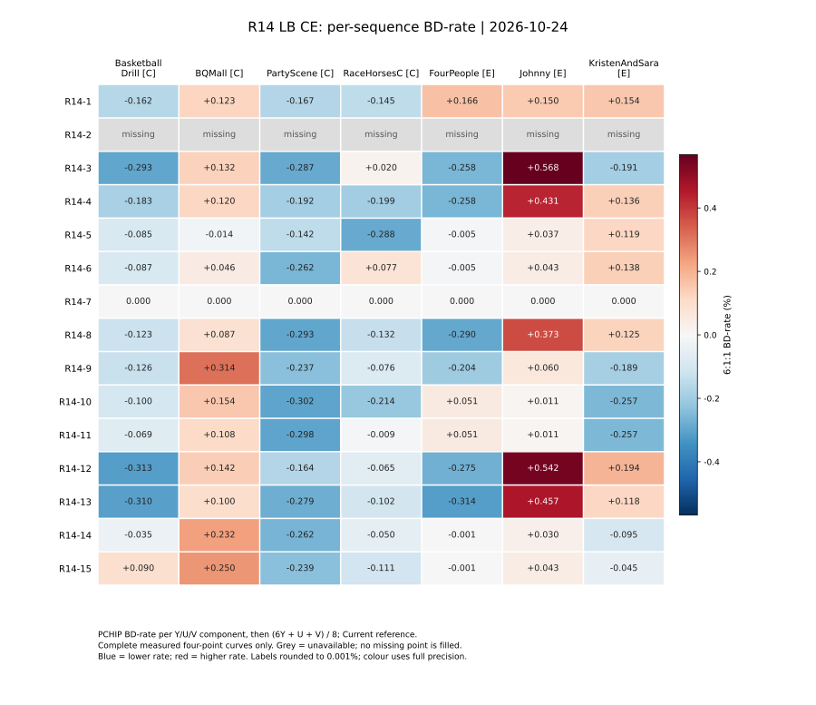
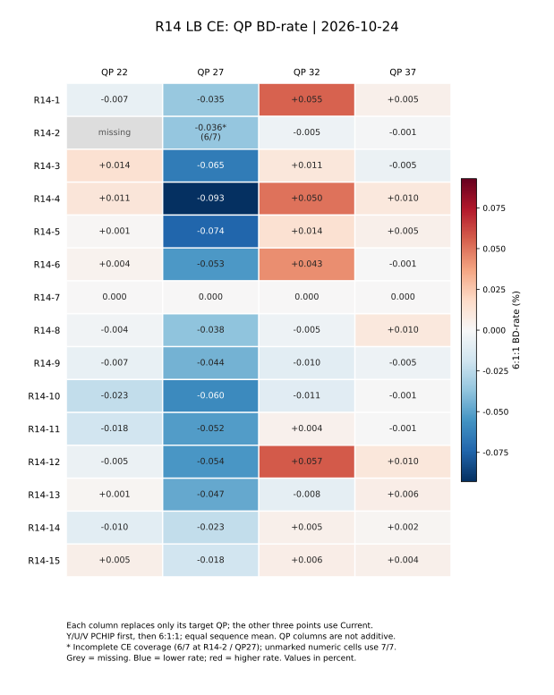

# R14 LB CE 结果分析：完整14组与实验2的正确部分结果

日期：2026-10-24。数据版本：结果登记提交`6c6a2fb`；编号`compact-15-v1`。
正式基线始终为Current，R13和R14固定权重仅作机制对照。本轮只分析，不修改算法、不运行编解码。

## 1. 结论

**R14-10是本轮首选动态候选，但R14尚未证明稳定优于原有R3-1/R6-2；整体评价为Weak，10值得继续验证。**

1. R14-10的CE为−0.093843%，与R3-1的−0.093288%、R6-2的−0.092172%几乎持平。
   直接以双方曲线重新积分，10对R3-1为+0.000250%，对R6-2为−0.000969%；
   不能把相差千分之几个百分点称为算法突破。三者优势序列不同。
2. 相对固定等权R13-1，10改善0.020800个百分点，但主要来自RaceHorsesC；去掉该序列后，
   其余六条平均差为+0.001975个百分点。动态学习的净增量还没有跨内容稳定性证据。
3. PAIR2并非普遍优于NONE：等权初态的10明显好于1，但半权初态的12差于3，零初态的14差于5。
   “更新更慢就更好”与“增加状态活动就更好”均不成立。
4. 初态影响仍明显。等权PAIR2的10/11保留R13-1的E类表现，半权初态的12/13继续出现Johnny大幅退化。
   现有RD结果与初态依赖一致，但不能由此推导状态不转移或实际转移率。
5. 固定权重9已有−0.065395%，优于多数动态组。它应保留为复杂度和动态增量对照；
   不能只比较动态方法与Current而省略固定比例。

## 2. 数据、口径与解释边界

- 15份R14 CSV共412/420个实测点；除2外14组各28/28完整。2正确版本20/28，缺全部QP22和PartyScene QP27。
- 不补点，不拼接其它实验的B类；本轮没有R14 B、RA、AI或服务器内部状态计数。
- 按每序列Y/U/V分别计算四点PCHIP BD-rate，再`(6Y+U+V)/8`。C四序列、E三序列等权，
  `CE=(4C+3E)/7`。单位均为%，负数改善。不是先平均PSNR，也不是C/E各占一半。
- QP列只替换对应实验RD点，其余三点使用Current；四列独立，不相加还原整体BD。
- 对Current的两项BD相减只称“差值，单位百分点”。直接方法间BD需以两组实际四点曲线重新积分，
  不能把上述差值当作直接BD-rate。
- 源表只读；生成台账`--check`通过。CSV状态pass和上报RD值不认证服务器源码/宏、帧数、配置或解码hash。
  没有可比整编码时间，本报告不声称R14已满足复杂度目标。

完整逐点、分量、来源与状态见[结果台账](TS_Predictor_Results_Ledger.md#15-r14lb-ce-更新结果2026-10-24仅记录)
和[R14明细](results/r14.md)。[初期报告](TS_Predictor_R14_Partial_Analysis_20261024.md)保留当时缺QP22、实验2排除的历史快照，
当前排名以本报告及更新台账为准。

## 3. 各组设置与整体表现

令近邻为L/U、远邻为D/LL/UU，评分为`K*N(p)+r*F(p)`，归一化远/近权重为`w=r/K`。
NONE每次有效反馈沿目标方向移动一个r档；PAIR2移动一个s微状态，`r=s>>1`。
状态在TU/分量/每次量化trial初始化，跨CG保留，CG被清零时回滚；不跨TU。
固定7/8/9分别使用w=0、1/4、3/4。

| 组 | 更新 / K / 初始w | C | E | CE | 逐序列改善/持平/退化 | 本轮判断 |
|---|---|---:|---:|---:|---:|---|
| 1 | NONE / 2 / 1 | −0.087511 | +0.156756 | +0.017175 | 3/0/4 | E三条全部退化，低优先级 |
| 2 | NONE / 4 / 1 |  |  |  |  | 正确部分数据已纳入，等补齐 |
| 3 | NONE / 2 / 1/2 | −0.107243 | +0.039605 | −0.044308 | 4/0/3 | Y改善强，但Johnny退化严重 |
| 4 | NONE / 4 / 1/2 | −0.113569 | +0.102996 | −0.020755 | 4/0/3 | C改善被E抵消，不优于3 |
| 5 | NONE / 2 / 0 | −0.132338 | +0.050380 | −0.054030 | 5/0/2 | 零初态组中最好，但收益主要来自V |
| 6 | NONE / 4 / 0 | −0.056283 | +0.058539 | −0.007074 | 3/0/4 | 整体收益很弱 |
| 7 | 固定 / 2 / 0 | 0 | 0 | 0 | 0/7/0 | 28个上报RD点与Current相同 |
| 8 | 固定 / 4 / 1/4 | −0.115295 | +0.069274 | −0.036194 | 4/0/3 | C好、E差，未优于已有固定等权 |
| 9 | 固定 / 4 / 3/4 | −0.031233 | −0.110944 | −0.065395 | 5/0/2 | 有价值的固定比例对照，BQMall退化大 |
| 10 | PAIR2 / 2 / 1 | −0.115464 | −0.065015 | **−0.093843** | 4/0/3 | 本轮首选，但仍需证明动态净增益 |
| 11 | PAIR2 / 4 / 1 | −0.067090 | −0.065015 | −0.066201 | 4/0/3 | E与10完全相同，C逊于10 |
| 12 | PAIR2 / 2 / 1/2 | −0.100186 | +0.153683 | +0.008615 | 4/0/3 | Johnny/KristenAndSara抵消C收益 |
| 13 | PAIR2 / 4 / 1/2 | **−0.147978** | +0.086951 | −0.047294 | 4/0/3 | C最强，但E问题未解决 |
| 14 | PAIR2 / 2 / 0 | −0.029158 | −0.022089 | −0.026128 | 5/0/2 | C/E均小幅改善，但增量不足 |
| 15 | PAIR2 / 4 / 0 | −0.002544 | −0.001042 | −0.001900 | 4/0/3 | 几乎无平均收益，局部却有明显正负变化 |

这里“改善序列数”按数值符号计数，不表示每条改善都有工程意义。尤其5的中位数仅−0.014085%，
11仅−0.009466%，15仅−0.000860%；不能只看改善序列数量。

## 4. 哪些机制获得支持，哪些没有

### 4.1 PAIR2的收益依赖初态

下表是相对Current的BD之差，单位百分点，负数表示PAIR2更好，不冒充两曲线直接BD。

| 配对：PAIR2 − NONE | 初始w / K | C差 | E差 | CE差 |
|---|---|---:|---:|---:|
| 10 − 1 | 1 / 2 | −0.027953 | −0.221771 | **−0.111018** |
| 11 − 2 | 1 / 4 |  |  |  |
| 12 − 3 | 1/2 / 2 | +0.007057 | +0.114078 | **+0.052923** |
| 13 − 4 | 1/2 / 4 | −0.034409 | −0.016045 | −0.026539 |
| 14 − 5 | 0 / 2 | +0.103179 | −0.072469 | **+0.027902** |
| 15 − 6 | 0 / 4 | +0.053739 | −0.059581 | +0.005173 |

10比1的优势主要是避免E类退化，不能全解释为学习到比原固定等权更好的规则。
14/15相对5/6也减少E退化，却损失更多C收益。PAIR2改变响应轨迹，作用有正有负。
2尚缺低QP，不能用其它QP小幅变化宣布11优于或劣于2的整体表现。

### 4.2 与固定初态比，动态增量并不普遍

固定w=1的评分对照是R13-1，固定w=1/2是R13-2，固定w=0是7。
这指相同历史输入上的评分对应关系，不宣称跨源码路径所有工具条件下已证明整码流等价。

| 动态组 | 固定初态对照 | CE差（百分点） |
|---|---|---:|
| 1 | R13-1 | +0.090218 |
| 10 | R13-1 | −0.020800 |
| 11 | R13-1 | +0.006842 |
| 3 | R13-2 | −0.000691 |
| 4 | R13-2 | +0.022862 |
| 12 | R13-2 | +0.052232 |
| 13 | R13-2 | −0.003677 |
| 5 / 6 | 7 | −0.054030 / −0.007074 |
| 14 / 15 | 7 | −0.026128 / −0.001900 |

3/13相对固定半权几乎没有平均增量，12甚至更差。零初态5虽优于零权固定对照，
仍明显不及固定等权R13-1，不能据此认为动态优于所有固定方案。

### 4.3 初态、步长和相位不能混为一个因素

- G2/G4同时改变网格数和单次权重步长（1/2对1/4），因此“G4更差”不能单独归因为细网格不好。
- PAIR2等权初态为`s=2K+1`：首次降权只改变相位，第二次才改变r。
- PAIR2半权初态为`s=K`，是低相位：首次降权立即改变r，首次升权只改变相位。
  因此10/11与12/13的比较同时包含初始比例和相位方向性，不能完全归因于初始比例。
- PAIR2不要求连续两次同向反馈；中性反馈保留相位。不能按“两次确认才更新”的模型解释它。

源码依据：[配置与输出档](../../source/Lib/CommonLib/TsFixedPrediction.h)、
[prepare/commit](../../source/Lib/CommonLib/TsR14Prediction.h)。本轮没有更改这些规则。

## 5. 逐序列：不是普适改善



| 实验 | BasketballDrill | BQMall | PartyScene | RaceHorsesC | FourPeople | Johnny | KristenAndSara |
|---|---:|---:|---:|---:|---:|---:|---:|
| R13-1 | −0.09290 | +0.11657 | −0.29213 | −0.05693 | +0.06035 | +0.01064 | −0.25690 |
| R13-2 | −0.28998 | +0.18725 | −0.26351 | −0.18789 | −0.31767 | +0.45552 | +0.11095 |
| R14-9 | −0.12556 | +0.31374 | −0.23709 | −0.07603 | −0.20357 | +0.06006 | −0.18931 |
| R14-10 | −0.10017 | +0.15424 | −0.30155 | −0.21438 | +0.05121 | +0.01064 | −0.25690 |
| R14-11 | −0.06855 | +0.10798 | −0.29833 | −0.00947 | +0.05121 | +0.01064 | −0.25690 |
| R14-13 | −0.31046 | +0.09969 | −0.27875 | −0.10239 | −0.31446 | +0.45706 | +0.11826 |
| R3-1 | −0.12191 | +0.01832 | −0.46899 | +0.00135 | −0.08251 | −0.13868 | +0.13941 |
| R6-2 | −0.15275 | +0.20509 | −0.31806 | +0.03119 | −0.13103 | +0.08592 | −0.36556 |

- **BQMall是共同弱项**：除7持平、5小幅改善外，完整组均退化；9达到+0.313743%，10为+0.154241%。
  不能仅凭分辨率或纹理描述给出启用规则，尚无工具活动证据说明具体原因。
- **Johnny区分等权和半权/低固定比例**：3/4/8/12/13分别+0.567907/+0.430924/+0.372680/+0.541515/+0.457058%。
  14个完整组中13组退化、7持平，没有改善组。不是“整个E都不好”：同组FourPeople通常明显改善。
  按Class E统一关闭将同时丢掉收益。
- **PartyScene多数方案改善**，因此它是有用的正向哨兵，但不足以区分候选。
- **RaceHorsesC决定10相对R13-1的额外收益**：单序列差−0.157454个百分点，
  分摊至七序列均值为−0.022493个百分点，比总体−0.020800还大；其余序列净效应略抵消。
- 10与11的差也主要来自RaceHorsesC：两组该序列差−0.204915个百分点，而E三序列完全相同。
- R14-10相对R3-1在RaceHorsesC/KristenAndSara更好，在PartyScene/Johnny/FourPeople等更差；
  相同总均值不代表机制相同或没有局部差异。

R14-10删除任意一条序列后对Current的六序列均值仍为负，范围−0.135191%～−0.059225%。
因此它对Current的绝对收益不依赖唯一序列；**依赖RaceHorsesC的是相对R13-1的额外收益**，二者不能混淆。

## 6. QP：QP27普遍改善，QP32暴露退化



每列仅替换目标QP，其余点用Current；不把四列解释为可相加的贡献。
除2/QP27是六条序列、2/QP22缺失外，各列均七条序列。

| 实验 | QP22 | QP27 | QP32 | QP37 |
|---|---:|---:|---:|---:|
| 1 | −0.006929 | −0.035280 | +0.054528 | +0.004929 |
| 2 |  | −0.035773（6/7） | −0.004768 | −0.000792 |
| 3 | +0.014112 | −0.064728 | +0.010707 | −0.005217 |
| 4 | +0.011302 | −0.092957 | +0.050255 | +0.009835 |
| 5 | +0.001367 | −0.073860 | +0.014059 | +0.004642 |
| 6 | +0.003511 | −0.053083 | +0.043363 | −0.000639 |
| 7 | 0 | 0 | 0 | 0 |
| 8 | −0.003630 | −0.037517 | −0.004888 | +0.009549 |
| 9 | −0.006746 | −0.044058 | −0.009531 | −0.004953 |
| 10 | −0.022789 | −0.059549 | −0.010541 | −0.000622 |
| 11 | −0.017802 | −0.051828 | +0.004302 | −0.000622 |
| 12 | −0.005431 | −0.054014 | +0.056688 | +0.010225 |
| 13 | +0.001493 | −0.047406 | −0.008349 | +0.006241 |
| 14 | −0.009942 | −0.022879 | +0.004647 | +0.002105 |
| 15 | +0.005180 | −0.017662 | +0.006293 | +0.004384 |
| R13-1 | −0.018756 | −0.065907 | +0.010393 | +0.001294 |
| R3-1 | −0.015305 | −0.076396 | +0.013187 | −0.014440 |
| R6-2 | −0.011328 | −0.070192 | −0.008779 | −0.001707 |

1. 除7持平外，所有组QP27的可用CE均值改善。仅凭QP27无法证明自适应机制有效。
2. 完整非零组中仅9和10的四个QP均值全部为负；这比只看总均值更有利，但不意味着每个序列/QP均改善。
3. 1/4/6/12在QP32明显退化，尤其E：1为+0.139446%、4为+0.136466%、12为+0.178450%。
   E类色度损失是主要风险之一。10的E/QP32仍+0.018821%，并未消除所有高QP风险。
4. 10比R13-1的QP27略差（−0.059549对−0.065907），主要改善点是QP32由+0.010393变为−0.010541，
   以及QP22小幅增强。不能把10解释为“在原来最好QP上进一步增强”。
5. QP37整体效应很小：10/11均−0.000622%；增大状态复杂度在这一列尚无工程收益证据。
   此时R3-1为−0.014440%，仍强于10的这一列。

## 7. 分量：Y改善不保证6:1:1改善，色度不能忽略

| 实验 | Y BD | U BD | V BD | 0.75Y贡献 | 0.125U贡献 | 0.125V贡献 | CE |
|---|---:|---:|---:|---:|---:|---:|---:|
| 9 | −0.077306 | +0.273355 | −0.332677 | −0.057979 | +0.034169 | −0.041585 | −0.065395 |
| 10 | −0.074808 | +0.094428 | −0.396329 | −0.056106 | +0.011804 | −0.049541 | −0.093843 |
| 11 | −0.051654 | +0.101379 | −0.321062 | −0.038740 | +0.012672 | −0.040133 | −0.066201 |
| 13 | −0.066833 | +0.324668 | −0.302023 | −0.050125 | +0.040584 | −0.037753 | −0.047294 |
| R13-1 | −0.061662 | +0.155589 | −0.369960 | −0.046246 | +0.019449 | −0.046245 | −0.073043 |
| R3-1 | −0.057117 | −0.102373 | −0.301228 | −0.042837 | −0.012797 | −0.037654 | −0.093288 |
| R6-2 | −0.053239 | −0.016591 | −0.401349 | −0.039929 | −0.002074 | −0.050169 | −0.092172 |

贡献列单位为百分点，可以相加成CE；这与不可相加的QP列不同。

- 10的Y和V各贡献约−0.05个百分点，收益并非只在Y；U仍损失+0.011804个百分点。
- 3的Y均值是本轮最好（−0.118587%），但U+0.293547%、V+0.063508%，最终只剩−0.044308%。
- 5的Y略退化+0.005699%，总体−0.054030%主要依赖V−0.436675%。它的好处不能解释为亮度预测更准。
- 13的Johnny中Y为−0.054378%，U/V却+1.303411%/+2.679321%，加权后+0.457058%。
  12同序列V甚至+3.186366%。色度虽各占1/8，仍足以改变方法排序。
- 不能从分量BD直接推导“只给Y启用”的闭环结果；分量启用改变搜索与量化路径，须另做独立编码才能验证。

## 8. 实验2：正确部分结果支持保留观察，尚不能排名

公平比较QP27时，所有方法均去掉PartyScene，只使用2已有的六条序列；QP32/37为完整七条。

| 方法 | QP27，同六条 | QP32，七条 | QP37，七条 |
|---|---:|---:|---:|
| 1 | −0.009075 | +0.054528 | +0.004929 |
| 2 | −0.035773 | −0.004768 | −0.000792 |
| 10 | −0.037066 | −0.010541 | −0.000622 |
| 11 | −0.026446 | +0.004302 | −0.000622 |
| R13-1 | −0.045272 | +0.010393 | +0.001294 |

现有覆盖中2比1的三列均值好，也比11好；和10比较则QP27/32稍差、QP37差异极小。
因此不能把2沿用旧版“不可靠”标签，也不能在它补齐前断言PAIR2优于NONE。
缺QP22会影响整体曲线与公共积分区间，禁止相加三列或补零给它估计完整CE名次。

## 9. 相同输出与状态活动

- 7的28/28上报RD四元组与Current相同，但源码存在不等于Current的反例；只能说本数据未观察到RD收益，
  不能说公式恒等Current、服务器宏必然未开或已验证bit-exact。
- 10与R13-1为14/28点相同，11为16/28；两者E均11/12相同，唯一不同位置是FourPeople QP22。
  Johnny、KristenAndSara两条完整曲线继承固定等权的数值。
- 10/11彼此E的12/12点相同；全CE的QP37七条也全部相同。
- RD不同意味着上报输出确有变化，但不能量化转移频率；RD相同也不证明没有内部状态变化。
  相位变而r不变、r变而predictor不变、predictor变而实际remapping不变、RDOQ反馈抵消等均可能存在。

源码反馈只比较命中时1、未命中C(a)或C(a+1)；若不同档赢家相同或当前档已达最小代价，反馈可中性。
prepare采用KeepHit损失，commit采用remap整数代价，二者目标不同；这为“降低了当前固定q上的整数代理代价，却未改善后续RD”提供可能机制，
尚无自然序列统计证明哪一项主导。已有统计的`sameWinners`、相位/权重改变、实际remapping、`g_next`才可进一步区分。
不能由当前表格编造TU尺寸、TS使用频率、状态驻留或跨CG可预测性结论。

## 10. 分布、直接对照与稳定性

以下按七序列整体BD统计，sample SD使用n−1分母；p10/p90采用线性百分位。
样本只有七条，百分位只描述当前内容离散程度。

| 组 | 中位数 | sample SD | p10 | p90 |
|---|---:|---:|---:|---:|
| 1 | +0.123210 | 0.164270 | −0.163779 | +0.159095 |
| 2 |  |  |  |  |
| 3 | −0.190909 | 0.315739 | −0.289696 | +0.306167 |
| 4 | −0.182611 | 0.255552 | −0.222623 | +0.253933 |
| 5 | −0.014085 | 0.132730 | −0.200389 | +0.070118 |
| 6 | +0.043294 | 0.132026 | −0.156859 | +0.101361 |
| 7 | 0 | 0 | 0 | 0 |
| 8 | −0.123479 | 0.243371 | −0.291075 | +0.223938 |
| 9 | −0.125557 | 0.194570 | −0.216980 | +0.161532 |
| 10 | −0.100165 | 0.172146 | −0.274762 | +0.092425 |
| 11 | −0.009466 | 0.154651 | −0.273471 | +0.073919 |
| 12 | −0.064748 | 0.304164 | −0.290006 | +0.333033 |
| 13 | −0.102392 | 0.288856 | −0.312062 | +0.253780 |
| 14 | −0.035321 | 0.147980 | −0.161969 | +0.110393 |
| 15 | −0.000860 | 0.154798 | −0.162196 | +0.154030 |

3/4/8/13的中位数比均值好很多，是少数大幅退化拖累；15均值近零而SD达0.154798%，
因此“平均没变化”不能推导“所有序列都没变化”。

以下直接BD重新使用左右两方法的实测四点曲线积分，**右列方法作为机制参考**，不改变正式Current anchor。
95%区间按七条序列配对重采样200,000次，seed=20261024；整条曲线保留，不把QP或系数当独立样本。

| 方法 / 参考 | 直接CE BD | 95%序列bootstrap区间 | 改善/持平/退化序列 |
|---|---:|---:|---:|
| 10 / Current | −0.093843 | [−0.209048, +0.025042] | 4/0/3 |
| 9 / Current | −0.065395 | [−0.181496, +0.080373] | 5/0/2 |
| 11 / Current | −0.066201 | [−0.176701, +0.032986] | 4/0/3 |
| 10 / R13-1 | −0.020708 | [−0.069988, +0.012535] | 4/2/1 |
| 10 / R3-1 | +0.000250 | [−0.161945, +0.135356] | 2/0/5 |
| 10 / R6-2 | −0.000969 | [−0.100201, +0.089838] | 3/0/4 |
| 10 / 9 | −0.028007 | [−0.109572, +0.077224] | 5/0/2 |
| 10 / 11 | −0.027616 | [−0.092320, +0.014787] | 3/3/1 |
| 10 / 1 | −0.110998 | [−0.224505, −0.016202] | 5/0/2 |

10对R3-1的直接BD与相对Current差值甚至符号不同：这反映公共积分区间和比率平均的差异，
不是数值实现错误，也说明不能给极小差异赋予优劣意义。
直接10/R13-1删去RaceHorsesC后为+0.002040%，与前述差值分析的结论一致。

这些是**探索性内容敏感度区间**：CTC七序列并非独立随机抽样的视频总体；未按类别分层，
未校正15组筛选带来的多重比较，也不估计重复编码噪声。即使10/1区间未跨零，
也只能说这个配对在当前内容上有较一致的优势，不能推出自适应总体成立。
其它关键增量区间跨零，与留一分析共同支持保守结论。

完整均值/极值/百分位、逐序列直接比较、留一与CI保存于
[分析派生表](results/r14_analysis_20261024/README.md)，不覆盖正式Current数值台账。

## 11. 后续优先级

1. **先补齐2的8个点**，完成等权G4下NONE/PAIR2对照，不立即淘汰2。
2. **如继续扩展B类，优先10，固定对照保留9与已有R13-1；R3-1/R6-2作为旧强方法对照。**
   10尚未超越它们，且当前没有可靠复杂度数据；不建议继续把全部15组扩展到B。
3. 只对少量既有方法补活动观察：10/R13-1关注RaceHorsesC与BQMall，1/10关注E/QP32，
   12/13关注Johnny。同时保留有利、无变化、退化内容，不按新结果只挑好序列。
   核对状态资格、不同档赢家、反馈平局、实际remapping、下一有效位置收益；这些诊断不替代闭环BD。
4. 暂不新增网格、阈值或分量/QP门控。优先确认动态增量是否可重复，是否能抵偿复杂度。
   若10对固定等权的增量仍只由少量序列支撑，应降低动态方向优先级，保留固定方案比较。

用户目标是**LB BCE**，不是CE。以10当前CE−0.093843%保持不变为条件，
由`BCE=(5B+7CE)/12`得到所需B均值：

| BCE目标 | B需达到 |
|---|---:|
| −0.05% | ≤+0.011381% |
| −0.08% | ≤−0.060619% |
| −0.10% | ≤−0.108619% |

这是目标换算，不是B结果预测，更不能把已有其它实验的B均值代入当作10的实测BCE。

## 12. 复算与本轮交付

在仓库根目录执行；只读取已登记数据，输出派生分析，不启动编解码：

```bash
python3 scripts/ts_results_ledger.py --date 2026-10-24 --check
python3 scripts/ts_r14_results_analysis.py --output-dir runs/r14_analysis_20261024
python3 scripts/plot_ts_r14_results.py
```

数值脚本检查完整实测曲线、相同anchor、缺点和QP共同集合，并用工作簿等价公式交叉核对直接BD，
最大差约3.60e−13个百分点；真实快照、重复键/混合anchor/非有限值/残缺元组/补点冒充完整曲线五类异常检查通过，
输入指纹保持不变。复算产物附五个输入CSV的SHA256、随机种子和指标定义。
未修改数值台账、历史原稿和编码器；新增分析报告、可复算脚本、图与小体积派生表。
